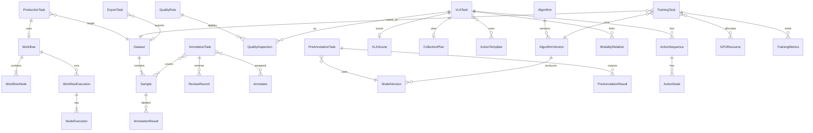

# 《数据库 ER 关系设计》

> 存储：PostgreSQL（元数据）+ 对象存储（媒体/权重/导出）+ Redis（队列）  
> 前缀：工程库表建议 `adf_`；业务 ID 可保留 `ORN-`/`ADF-` 字符串主键以兼容前端。

---

## 1. ER 总图

---

## 2. 核心实体字段（摘要）

### 2.1 生产与编排

**ProductionTask**：id, name, type, description, source, data_type, dataset_id, workflow_id, workflow_version, executor_ids[], reviewer_ids[], priority, schedule_at, complete_condition(json), status, created_at  

**Workflow**：id, name, description, latest_version, status  

**WorkflowNode**：id, workflow_id, version, node_key, node_type, params(json), retry_policy(json), ui_position(json)  

**WorkflowExecution**：id, production_task_id, workflow_id, version, status, started_at, finished_at, error  

**NodeExecution**：id, execution_id, node_key, status, attempt, logs, input_ref, output_ref, started_at, finished_at  

### 2.2 数据与标注

**Dataset**：id, name, modality, version, sample_count, source, created_at  
**Sample**：id, dataset_id, modality, uri, meta(json), status, task_id  
**AnnotationTask**：对齐现有 QC 工单字段 + status  
**AnnotationResult**：id, sample_id, task_id, modality, labels(json), version, created_by  
**Annotator**：user_id, skills[], workload_stats(json)  
**ReviewRecord**：id, task_id, level, action, comment, actor_id, created_at  
**QualityRule**：id, name, ratio, count_limit, scope(json), threshold, enabled  
**QualityInspection**：id, rule_id, target_type, target_id, result(json), status  

### 2.3 预标注

**PreAnnotationTask**：id, modality, model_version_id, params(json), sample_ids[], status, progress  
**PreAnnotationResult**：id, task_id, sample_id, model_output(json), human_correction(json), final_output(json), conf  

### 2.4 VLA

**VLATask**：采集任务全字段  
**VLAScene**：场景字段  
**CollectionPlan**：方案字段  
**ActionTemplate**：模板字段  
**ActionSequence**：id, task_id, sample_id, order_no, action_type, start_ts, end_ts, start_frame, end_frame, semantic  
**ActionNode**：id, sequence_id, name, node_type, ts, frame_index, image_id, semantic, tags[]  
**ModalityRelation**：id, task_id, sample_id, from_type, from_id, to_type, to_id, via(timestamp|frame)  

### 2.5 训练

**Algorithm** / **AlgorithmVersion** / **ModelVersion**  
**TrainingTask**：超参、状态、gpu_ids、dataset_id、log_path、ckpt_best  
**TrainingMetrics**：task_id, epoch, train_loss, val_loss, acc, precision, recall, map, lr, elapsed_sec  
**GPUResource**：id, name, model, mem_total, mem_used, util, status  
**ExportTask**：id, format, source_type, source_id, file_uri, status  

### 2.6 公共

User, Role, Project, LabelSchema, FileObject, AuditLog, Notification

---

## 3. 状态枚举（库内）

统一使用小写 snake；前端展示中英文映射。  
所有写操作建议附 `updated_at` + `updated_by`；关键表保留 `operation_logs` 或写全局 AuditLog。

---

## 4. 索引建议

- `annotation_task(status, assignee_id, updated_at)`  
- `sample(dataset_id, status)`  
- `node_execution(execution_id, status)`  
- `training_metrics(task_id, epoch UNIQUE)`  
- `action_sequence(task_id, sample_id)`  
- `modality_relation(task_id, sample_id)`  

---

## 5. 迁移策略

1. 以现有 mock 对象为种子导入脚本。  
2. 前端 ID 字符串主键阶段可继续用；后期可加 UUID 内部键。  
3. 媒体文件迁到对象存储后 Sample.uri 改签名路径。
