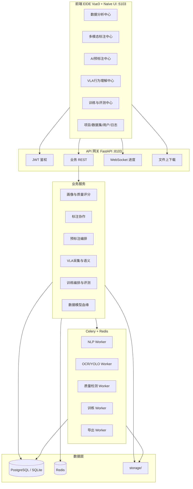
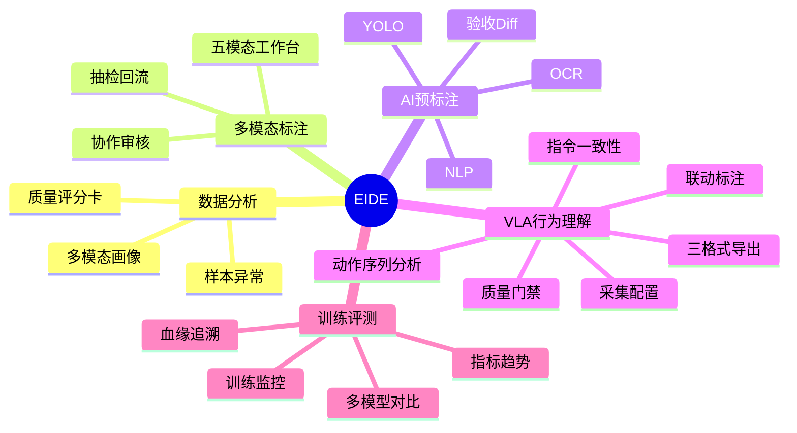

# 《系统架构设计文档》

> 产品：EIDE  
> 风格：Naive UI 深色「分析工作台」— 图标轨 + 分析面板 + 底部 Console

---

## 1. 逻辑架构

---

## 2. 业务能力地图

---

## 3. 与前三套架构差异

| 维度 | 数联 | AI Data Factory | 星算 | **EIDE** |
|------|------|-----------------|------|----------|
| 前端壳 | Element 侧栏工单 | AntD 顶栏 SaaS | Arco 算力仪表 | Naive 深色分析轨 |
| 后端端口 | 8101 | 8102 | 8000/8104 | **8103** |
| 核心新增服务 | 工单审计 | 生产编排 | GPU 池 | **Profile/Eval/Lineage** |
| 首页 | 待办工单 | Tour+生产舱 | GPU 仪表 | **数据智能驾驶舱** |

四套后端进程与库文件隔离，禁止共享 mock 状态。

---

## 4. 部署拓扑（演示）

| 组件 | 建议 | 说明 |
|------|------|------|
| `vla-demo-naive` | Vite `:5103` | EIDE 前端 |
| `eide-platform/backend` | uvicorn `:8103` | REST + WS |
| Redis | `:6379`（可独立 DB index） | 队列/进度 |
| Celery worker | 同机 | 推理/质检/训练 |
| DB | SQLite `eide.db` 或 Postgres | 演示默认 SQLite |
| storage/ | `eide-platform/storage` | 媒体与产物 |

---

## 5. 技术选型（锁定）

| 层 | 选型 | 理由 |
|----|------|------|
| 前端 | Vue3 + Naive UI + ECharts | 保留深色分析台人设 |
| 后端 | FastAPI + SQLAlchemy 2 | Python 算法同栈 |
| 队列 | Celery + Redis | 异步推理/训练 |
| NLP | transformers / spaCy（可降级规则） | CPU 可跑 |
| OCR | PaddleOCR | 中文成熟 |
| 检测 | Ultralytics YOLOv8n | 轻量 CPU |
| 质检 | OpenCV 启发式 + 可选模型 | 抖动/模糊/遮挡 |
| 音频 | FFmpeg + VAD | 切片落盘 |
| 点云 | Three.js（P1） | 真三维 |
| 训练 | PyTorch mini task | 真实 loss 写库 |
| 导出 | openpyxl / csv / json | 服务端归档 |

---

## 6. 关键设计决策

1. **前端 service 适配层**：保留 `services/*.js` 函数签名，内部改为 HTTP；本地无后端时可降级 mock，但首页显示「演示数据模式」。  
2. **结果溯源字段**：所有算法结果带 `source_mode: real|test`、`model_version`、`latency_ms`。  
3. **评测与训练分离**：训练产出 checkpoint；评测任务独立绑定数据集与模型版本，支持横比。  
4. **血缘图**：以 `lineage_edge` 表存储派生关系，前端用关系图展示。  
