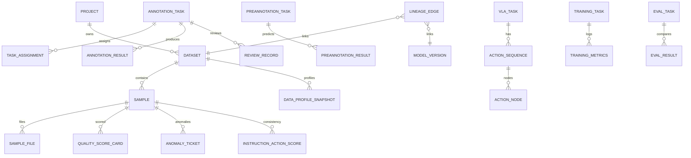

# 《数据库 ER 设计》

> 引擎：PostgreSQL 15+（演示可用 SQLite `eide.db`）  
> ORM：SQLAlchemy 2.x  
> 约定：业务主键字符串（`EIDE-*`）或 UUID；`created_at`/`updated_at`；软删 `deleted_at`。

---

## 1. 表清单

### 1.1 用户与权限

| 表 | 关键字段 |
|----|----------|
| `user` | id, username, password_hash, name, org_id, status |
| `role` | id, code(`annotator/reviewer/admin/analyst/evaluator`), name |
| `permission` / `user_role` / `role_permission` | 标准 RBAC |
| `organization` | id, name, parent_id |

### 1.2 项目与数据资产

| 表 | 关键字段 | 关联 |
|----|----------|------|
| `project` | id, name, code, owner_id, status | → user |
| `dataset` | id, project_id, name, modality, version, quality_score | → project |
| `sample` | id, dataset_id, name, modality, status, meta_json, quality_score | → dataset |
| `sample_file` | id, sample_id, file_type, path, checksum, duration_ms, width, height | |
| `label_schema` / `label_item` | 标签体系树 | |
| `file_asset` | 通用文件 | |

### 1.3 数据画像与质量（EIDE 特色）

| 表 | 关键字段 |
|----|----------|
| `data_profile_snapshot` | id, dataset_id, scope(dataset/task/sample), stats_json, created_at |
| `quality_score_card` | id, target_type, target_id, total_score, dim_json, rule_version, created_at |
| `anomaly_ticket` | id, sample_id, issue_type, severity, location_json, status, handler_id, resolution |

### 1.4 标注协作与质控

| 表 | 关键字段 / 状态机 |
|----|-------------------|
| `annotation_task` | id, project_id, dataset_id, modality, status, priority, spec_id |
| `task_assignment` | task_id, user_id, role, sample_ids_json |
| `annotation_result` | task_id, sample_id, version, payload_json, mask_path, actor_id |
| `annotation_comment` | task_id, sample_id, author_id, body |
| `review_record` | task_id, level(1-3), reviewer_id, decision, comment |
| `review_history` | from_status, to_status, actor_id, reason |
| `quality_rule` / `quality_inspection` / `quality_record` | 抽检闭环 |

**status**：`pending_assign` → `pending_annotate` → `annotating` → `pending_review` → `reviewing` → `passed`；驳回 `rejected` → `pending_rework` → `resubmitted`。

### 1.5 预标注

| 表 | 关键字段 |
|----|----------|
| `preannotation_task` | dataset_id, model_version_id, params_json, status, progress, source_mode |
| `preannotation_result` | model_payload, human_payload, diff_json, conf, confirmed, latency_ms |

### 1.6 VLA 行为理解

| 表 | 关键字段 |
|----|----------|
| `vla_task` | project_id, scene_id, plan_id, mode, robot_model, device_no, status |
| `vla_scene` / `collection_plan` / `action_template` | 配置实体 |
| `action_sequence` | vla_task_id, sample_id, order_no, action_type, start/end_ts/frame, desc |
| `action_node` | sequence_id, name, type, timestamp, frame_idx, labels_json |
| `modality_relation` | sample_id + 多模态文件/指令/序列引用 + timestamp |
| `frame_annotation` | sample_id, frame_idx, payload_json |
| `instruction_action_score` | sample_id, instruction, score, mismatch_json, method |
| `vla_quality_task` / `vla_quality_result` | 五类检测 |

### 1.7 训练、评测与血缘

| 表 | 关键字段 |
|----|----------|
| `algorithm` / `algorithm_version` | 算法注册 |
| `model` / `model_version` | 权重路径、配置、状态 |
| `training_task` / `training_config` | 超参、增强、设备 |
| `training_metrics` | epoch, train/val_loss, accuracy, precision, recall, map_value, map_metric, lr, elapsed_sec |
| `gpu_resource` / `gpu_allocation` | 算力 |
| `eval_task` | name, dataset_id, model_version_ids_json, metrics_json, status |
| `eval_result` | eval_task_id, model_version_id, metric_name, metric_value, detail_json |
| `lineage_edge` | from_type, from_id, to_type, to_id, relation(`derived_from/trained_on/evaluated_on`) |
| `export_task` / `operation_log` | 导出与审计 |

---

## 2. ER 关系图

---

## 3. 索引建议

- `sample(dataset_id, modality, status)`  
- `annotation_task(status, project_id)`  
- `training_metrics(task_id, epoch)` UNIQUE  
- `eval_result(eval_task_id, model_version_id, metric_name)`  
- `lineage_edge(from_type, from_id)` / `(to_type, to_id)`  
- `anomaly_ticket(issue_type, status)`  

---

## 4. 迁移与回滚

- Alembic 版本链；演示可用 `create_all` + seed。  
- 破坏性变更必须提供 downgrade；生产禁止无备份 migrate。  
