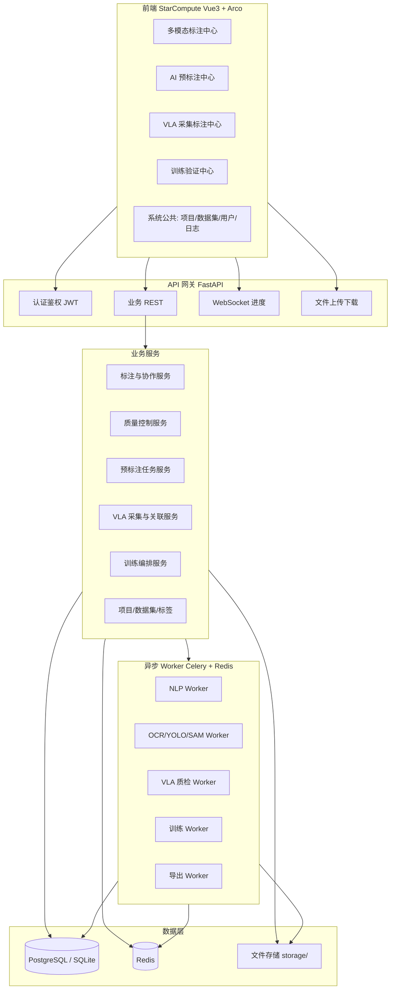
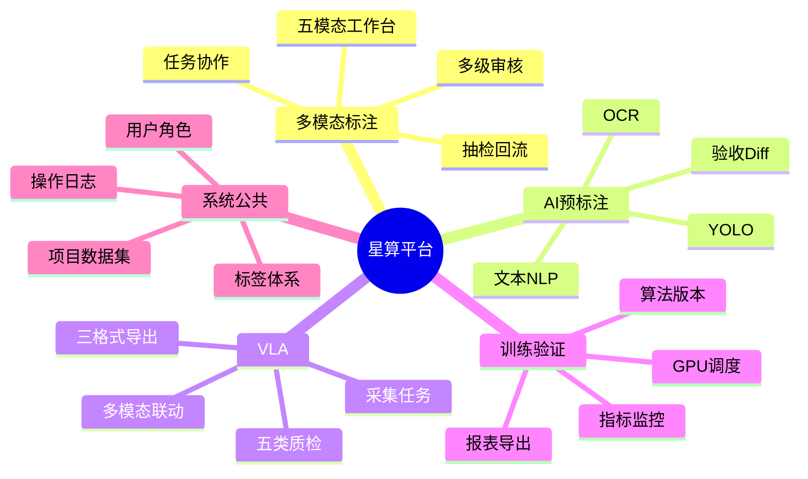
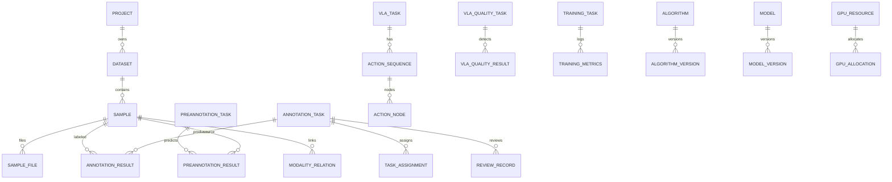

# 《系统功能架构图》

## 1. 逻辑架构

## 2. 业务中心能力地图

## 3. 核心数据关联

## 4. 部署拓扑（演示环境）

| 组件 | 建议 | 说明 |
|------|------|------|
| `vla-demo-arco` | Vite dev :5104 | 前端 |
| `platform/backend` | uvicorn :8000 | REST + WS |
| Redis | :6379 | 队列 / 进度 |
| Celery worker | 同机 | 推理与训练 |
| DB | SQLite 文件或 Postgres | 演示默认 SQLite |
| storage/ | 本地目录 | 媒体与模型产物 |

生产可替换为 MinIO + PostgreSQL + 多 GPU Worker。

## 5. 技术选型（已锁定）

| 层 | 选型 | 理由 |
|----|------|------|
| 前端 | 复用 Vue3 + Arco | 保留星算人设与评分路径 |
| 后端 | FastAPI + SQLAlchemy 2 | 与 Python 算法生态同栈 |
| 任务队列 | Celery + Redis | 异步推理/训练标准方案 |
| NLP | transformers / spaCy（可降级规则+词典） | 可 CPU 跑 |
| OCR | PaddleOCR | 成熟中文 OCR |
| 检测 | Ultralytics YOLOv8n | 轻量可 CPU |
| 分割辅助 | SAM 可选 / 多边形人工 | 演示优先人工多边形+导出 mask |
| 音频 | FFmpeg + 简易 VAD | 切片落盘 |
| 视频/质检 | OpenCV | 抖动/模糊/遮挡启发式 + 可选模型 |
| 点云 | Three.js 前端 + Open3D 后端可选 | 真三维交互 |
| 训练 | PyTorch 迷你任务 | 真实 loss 曲线写入 DB |
