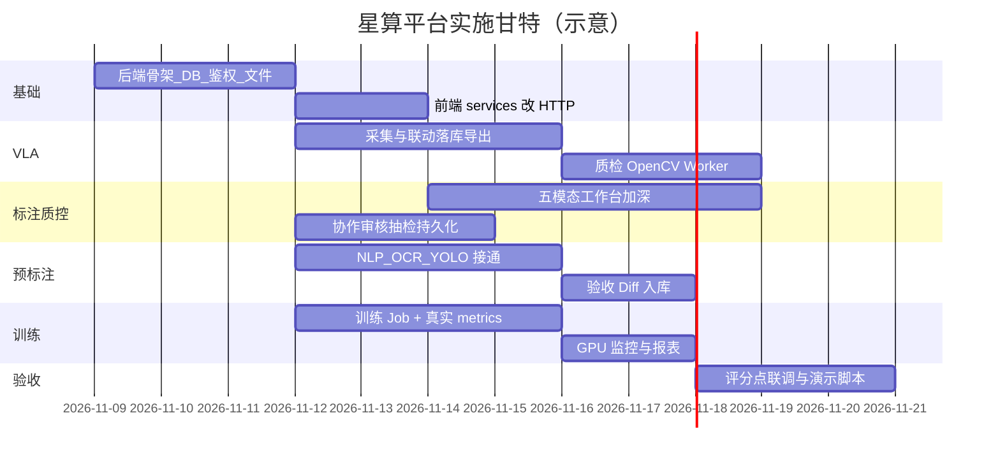

# 《四大模块研发计划》

## 0. 总体策略

- **复用** `vla-demo-arco` 前端壳与 `services/*` API 形状  
- **新建** `platform/backend` + `platform/workers` + `platform/algo`  
- 按评分权重与演示依赖排序：**C(VLA 8分) → A(4) → B(4) → D(4)**，但基础设施（鉴权/DB/文件）先行  



---

## 1. 里程碑

| 里程碑 | 交付 | 验收 |
|--------|------|------|
| M0 | 设计 10 件套文档 | 本文档集齐 |
| M1 | FastAPI + DB + 登录 + 文件 | curl 可 CRUD 样本 |
| M2 | QC/VLA/Prelabel/Train API 替换 mock | 前端连真实 API，刷新不丢 |
| M3 | YOLO/OCR/NLP/质检 Worker | 上传图可出真实框 |
| M4 | 标注工作台加深（多边形/逐帧/点云） | 可录 1.1 分项 |
| M5 | 训练真实 metrics | 曲线来自 DB |
| M6 | 15 分钟演示联调 | 脚本走通 |

---

## 2. 分模块任务包

### A. 多模态标注（4 分）

1. 任务/分配/流转/批注/审核 API + 表  
2. 文本拖选 + 关系  
3. Canvas 多边形 + mask 导出  
4. wavesurfer 语音切片  
5. 视频逐帧 bbox + track_id  
6. Three.js 点云  
7. 抽检规则/回流 Dataset  

### B. 预标注（4 分）

1. 预标任务队列  
2. NLP pipeline Worker  
3. OCR/YOLO Worker  
4. Diff 对比与验收状态机  

### C. VLA（8 分）

1. 场景/方案/模板/设备 CRUD  
2. 联动标注保存 modality_relation  
3. 服务端三格式导出 + export_task  
4. 五类质检算法 + 复核过滤  

### D. 训练（4 分）

1. 算法/模型版本  
2. GPU 资源表（NVML 或模拟利用率但任务真实）  
3. PyTorch 迷你训练写 metrics  
4. 增强预览与报表  

---

## 3. 工程目录

```
E:\omp\vla\
  vla-demo-arco\          # 前端（改造 services）
  platform\
    backend\              # FastAPI
    workers\              # Celery app
    algo\                 # 推理/训练实现
    storage\              # 文件与权重
  docs\product\starcompute-arco\
```

---

## 4. 风险与回滚

| 风险 | 回滚 |
|------|------|
| 重型依赖装不上 | `ALGO_MODE=lite` OpenCV 路径 |
| 前端改造过大 | services 双模式：`VITE_API_BASE` 空则走 mock |
| 训练无 GPU | CPU 2–5 epoch 小网络，仍写真实 loss |

前端双模式保证演示随时可回退纯前端。
